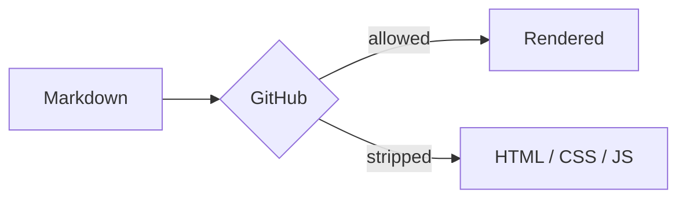

<!--
  GitHub Profile README — kitchen sink
  Replace YOUR_USERNAME / YOUR NAME / links. Delete anything you don't need.
  Profile README requirements: repo named YOUR_USERNAME, public, README.md at root, non-empty.
  GitHub strips CSS/JS/iframes; gradient text is an SVG image, not CSS.
-->

<a name="top"></a>

<div align="center">


<h1>Hi 👋, I'm YOUR NAME</h1>
<h3>I build useful things for the web.<br />TypeScript · Go · Rust · Postgres</h3>

[](https://github.com/YOUR_USERNAME)
[](https://github.com/YOUR_USERNAME?tab=followers)
[](https://github.com/sponsors/YOUR_USERNAME)

</div>


<details>
<summary>Contents</summary>

- [About](#about-me)
- [Stats](#stats)
- [Alerts](#alerts)
- [Renderer playground](#renderer-playground)
- [What does not work](#what-does-not-work)
- [Gradient text](#gradient-text)

</details>

---

## About me

<details>
<summary><strong>Click for the longer version</strong></summary>

- 🔭 Currently building **something**
- 🌱 Learning **something else**
- 💬 Ask me about **anything**
- 📫 Reach me at **you@example.com**
- ⚡ Fun fact: **...**

</details>

<table>
  <tr>
    <td width="50%" valign="top">
      <h3>Currently</h3>
      <ul>
        <li>Building ...</li>
        <li>Reading ...</li>
        <li>Listening to ...</li>
      </ul>
    </td>
    <td width="50%" valign="top">
      <h3>Toolbox</h3>
      
    </td>
  </tr>
</table>

## Stats

<div align="center">


</div>

> [!NOTE]
> These cards are third-party images, not GitHub features. They can be rate-limited or down. Self-host or generate static SVGs with Actions for reliability.

## Alerts

> [!NOTE]
> Useful information.

> [!TIP]
> Helpful advice.

> [!IMPORTANT]
> Key information.

> [!WARNING]
> Urgent info.

> [!CAUTION]
> Risk warning.

## Renderer playground

This section is a live demo of GitHub's Markdown pipeline.[^gfm] Delete it for a clean profile.

### Text styles

**Bold**, *italic*, ***bold italic***, ~~struck~~, <ins>underlined</ins>, <sub>subscript</sub>, <sup>superscript</sup>, <kbd>Ctrl</kbd>+<kbd>K</kbd>, <mark>highlighted</mark>, `inline code`, [a link](https://github.com), and \*escaped\*.

> Blockquote.
>
> > Nested blockquote.

Two trailing spaces also force a break, but editors often strip them.  
This line follows a two-space break.

A backslash also works.\
This line follows a backslash break.

<br />

### Lists

- Unordered
  - Nested
    - Deeper
- [x] Done
- [ ] Todo
  - [x] Nested done

3. Starts at three
4. Next

### Table

| Left | Center | Right | Inline HTML |
| :--- | :----: | ----: | :---------- |
| `code` | **bold** | ~~strike~~ | <kbd>K</kbd> |
| [link](#renderer-playground) | <mark>mark</mark> | <sub>sub</sub> | <sup>sup</sup> |
| escaped pipe | `a \| b` | line<br>break | <ins>ins</ins> |

### Code

```bash
git clone https://github.com/YOUR_USERNAME/YOUR_USERNAME.git
```

```ts
type Greeting = { name: string };
const greet = ({ name }: Greeting) => `Hello, ${name}!`;
```

```diff
- const old = true;
+ const shiny = true;
```

```json
{ "renderer": "gfm", "gradientText": "svg-only" }
```

### Math

Inline $E = mc^2$.

```math
\int_{-\infty}^{\infty} e^{-x^2}\,dx = \sqrt{\pi}
```

### Mermaid



### GeoJSON

```geojson
{
  "type": "FeatureCollection",
  "features": [
    {
      "type": "Feature",
      "properties": { "name": "Null Island" },
      "geometry": {
        "type": "Polygon",
        "coordinates": [[[-1, 0], [1, 0], [1, 1], [-1, 1], [-1, 0]]]
      }
    }
  ]
}
```

### STL

```stl
solid tetra
  facet normal 0 0 -1
    outer loop
      vertex 0 0 0
      vertex 1 0 0
      vertex 0 1 0
    endloop
  endfacet
  facet normal 0 -1 0
    outer loop
      vertex 0 0 0
      vertex 0 0 1
      vertex 1 0 0
    endloop
  endfacet
  facet normal -1 0 0
    outer loop
      vertex 0 0 0
      vertex 0 1 0
      vertex 0 0 1
    endloop
  endfacet
  facet normal 0.577 0.577 0.577
    outer loop
      vertex 1 0 0
      vertex 0 1 0
      vertex 0 0 1
    endloop
  endfacet
endsolid tetra
```

### HTML that works

<p align="center"><strong>Centered with <code>align="center"</code></strong></p>

<dl>
  <dt><strong>Term</strong></dt>
  <dd>Definition list via raw HTML.</dd>
</dl>

<p>
  <kbd>Ctrl</kbd> + <kbd>K</kbd> ·
  <mark>mark</mark> ·
  <ins>inserted</ins> ·
  <del>deleted</del> ·
  <s>struck</s> ·
  <q>quote</q> ·
  <var>x</var> ·
  <samp>output</samp> ·
  <ruby>漢<rp>(</rp><rt>kan</rt><rp>)</rp></ruby>
</p>

<table>
  <tr><th>Merged</th><th>Header</th></tr>
  <tr><td rowspan="2">A</td><td>B</td></tr>
  <tr><td>C</td></tr>
</table>

### Images


A right-aligned image wraps text. Use `<br clear="all" />` if the next block needs to clear it.

<br clear="all" />

<picture>
  <source media="(prefers-color-scheme: dark)" srcset="https://placehold.co/600x120/0d1117/ffffff?text=Dark+mode" />
  <source media="(prefers-color-scheme: light)" srcset="https://placehold.co/600x120/ffffff/000000?text=Light+mode" />
  
</picture>

### Details

<details>
<summary>Nested details</summary>

<details>
<summary>Inner</summary>

Markdown renders here because of the blank lines.

</details>

</details>

<details open>
<summary>Open by default</summary>

This one starts expanded.

</details>

### Emoji and entities

:rocket: :sparkles: :shipit: :octocat: &nbsp; &copy; &mdash; &#x1F680;

### Links

[Reference link][gh] · [Collapsed][] · [Jump to top](#top) · [Relative](README.md) · [External](https://github.com) · <https://github.com> · <you@example.com>

[gh]: https://github.com
[collapsed]: https://github.com

---

## What does not work

- `style="..."` and `class="..."` — stripped. No CSS, custom colors, fonts, or gradient text.
- `<style>`, `<script>`, `<iframe>`, `<object>`, `<embed>`, `<form>`, `<input>`, `<button>` — stripped or escaped.
- Inline `<svg>` — stripped. Use an SVG file through ``.
- `<video>` — a bare `<video src>` can survive the sanitizer, but README playback is inconsistent; `<source>` children lose their `src`, and `poster` is stripped. Use a GIF, animated SVG, or link.
- `data:image/...` — blocked. Host images in the repo or on HTTPS.
- Protocol-relative (`//...`) and `ftp://` images — blocked.
- `==highlight==` and `^sup^` — not GFM. `~text~` is strikethrough, not subscript. Use `<mark>`, `<sup>`, `<sub>`.
- Color swatches like `#0969DA` — work in issues/PRs/discussions, not READMEs.
- `#123`, `GH-123`, commit SHAs — autolink in conversations, not in README files. Use full URLs.
- `@mentions` — render, but don't rely on notifications from a README.
- Alerts inside `<details>` or lists — become plain blockquotes. Keep alerts top-level.
- Markdown inside `<summary>` — not parsed. Use `<strong>`/`<code>`.
- Markdown inside `<div>`/`<details>` — needs blank lines around it.
- Tables — no block elements. Use `<br>` for line breaks; raw HTML tables for `rowspan`/`colspan`.
- Code fences — no line numbers, line highlighting, or filename captions.
- `<abbr>`, `<figure>`, `<time>`, `<small>`, `<bdo>`, `<center>`, `<font>`, `<u>`, `<big>`, `<cite>`, `<dfn>`, `<wbr>` — stripped (some leave text behind).
- ``, `srcset`, `border` — stripped. `style` and `class` are stripped everywhere.
- `target="_blank"` — stripped; links open in the same tab. `rel` survives; `download` is stripped.
- Profile README — no automatic Outline/TOC in the profile embed. Add your own.
- Long READMEs — the repo/profile view truncates around ~512 KB. Keep it far below.
- Uploads — 10 MB for images/GIFs; 10 MB video on free plans, 100 MB on paid; 25 MB for other files.
- External images — proxied and cached by Camo; updates can lag.
- GitHub Pages, Jekyll, VS Code preview, and other Markdown renderers — different pipelines. Test on github.com.

## Gradient text

CSS cannot do it: `style`/`class` are stripped. Add `assets/gradient.svg`, then:

```markdown

```

The SVG source is below. It is an image: not selectable text. Keep a real `<h1>` for accessibility.

---

<div align="center">

**Thanks for stopping by.**<br />
[Website](https://example.com) · [X](https://x.com/YOUR_USERNAME) · [LinkedIn](https://linkedin.com/in/YOUR_USERNAME)

</div>

[^gfm]: GFM plus GitHub's extensions: alerts, footnotes, math, Mermaid, GeoJSON, TopoJSON, and STL. The renderer sanitizes HTML; CSS and JavaScript never run.
